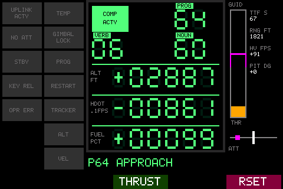
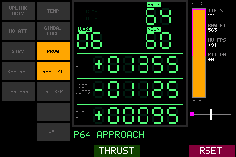
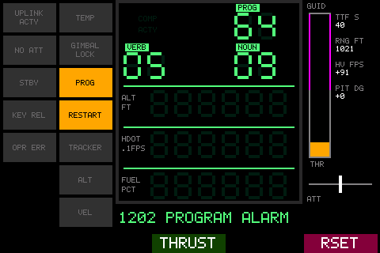
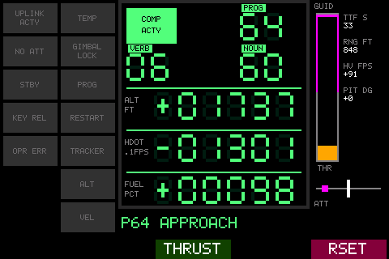
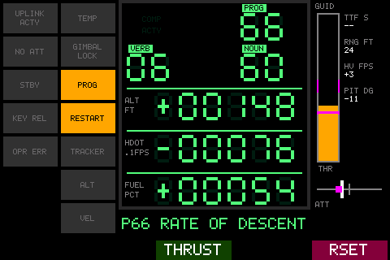
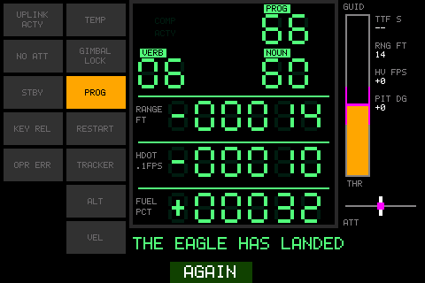
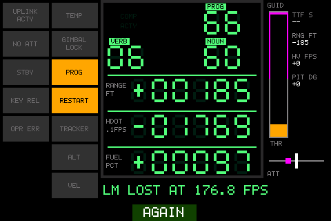
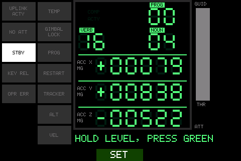
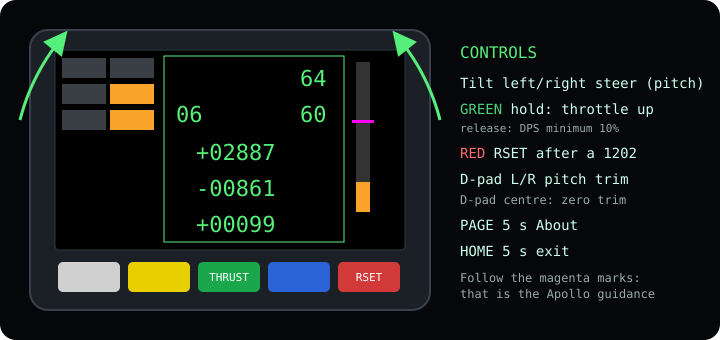
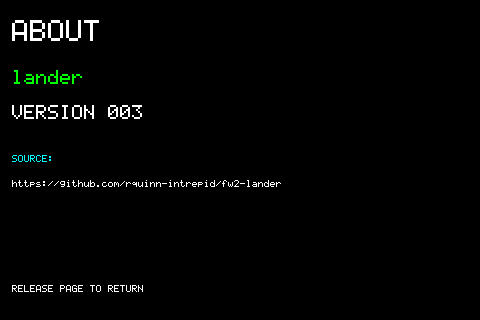

# lander

**Fly the last few minutes of an Apollo landing on a FreeWili 2.**
The screen is a DSKY: the same PROG / VERB / NOUN display and green
registers the Apollo crews watched. The descent guidance follows the Apollo 11
landing software (Luminary 099), and it shows you what it would do. You fly.
And yes, at 2000 ft you get the **1202 alarm**.

<p align="center">
  
</p>

---

## Screenshots

<table>
  <tr>
    <td align="center"><br><sub>Throttle up (GREEN held)</sub></td>
    <td align="center"><br><sub>Program alarm 1202: V05 N09, PROG + RESTART</sub></td>
  </tr>
  <tr>
    <td align="center"><br><sub>After RSET: back to V06 N60</sub></td>
    <td align="center"><br><sub>P66 at 148 ft: slow the descent, keep it level</sub></td>
  </tr>
  <tr>
    <td align="center"><br><sub>Touchdown at 1.0 ft/s with 32% fuel: THE EAGLE HAS LANDED</sub></td>
    <td align="center"><br><sub>Too fast: LM lost</sub></td>
  </tr>
  <tr>
    <td align="center" colspan="2"><br><sub>Setup: the registers show the live accelerometer</sub></td>
  </tr>
</table>

## Controls

<p align="center"></p>

| Input | Action |
| --- | --- |
| **Tilt** the board left / right | Steer (LM pitch) |
| Hold **GREEN** | Throttle up; release drops to the engine's 10% minimum |
| **RED** | RSET: clear the PROG / RESTART lamps after the 1202 |
| D-pad left / right | Pitch trim (the only steering if no IMU is found); centre zeroes it |
| Hold **PAGE** 5 s | About screen |
| Hold **HOME** 5 s | Back to the FreeWili menu |

## Reading the screen

| Where | What |
| --- | --- |
| **PROG** | 64 = approach (quadratic guidance), 66 = rate of descent near the ground |
| **R1** | Altitude, feet |
| **R2** | Altitude rate, tenths of ft/s (negative = descending) |
| **R3** | Fuel, percent |
| **GUID panel** | Orange bar = your throttle, white needle = your pitch. **Magenta marks = what the Apollo guidance wants.** Keep yours on them. |
| **Lamps** | PROG / RESTART: the 1202. ALT: falling too fast for your altitude. VEL: too much sideways speed near the ground. GIMBAL LOCK: tilted past 40° |
| **Messages** | `60 SECONDS` / `30 SECONDS` fuel callouts, `CONTACT LIGHT` just before touchdown |

**Soft landing:** descent ≤ 6.6 ft/s, sideways ≤ 1.2 m/s, within 12° of upright.

**Bottom-heavy:** at minimum throttle, small tilts (up to 12°) are ignored and
the LM rights itself, so an unsteady hand does not tip you into a crash.

## How to play

1. Open **lander** from the board's App Explorer.
2. Hold the board how you will fly and press GREEN; tilt it right and press
   GREEN. The game learns your steering direction.
3. You start at P64 high gate: about 3300 ft up and 2300 ft short of the site,
   coming in fast. Hold GREEN to brake, tilt to steer, follow the magenta.
4. At 2000 ft the computer throws a **1202**. Keep flying; press RED to clear it.
5. Below 150 ft the program drops to **P66**. Bring it down slow and level.

## The Apollo guidance, briefly

From `LUNAR_LANDING_GUIDANCE_EQUATIONS.agc` in Luminary 099:

- **P64:** each pass advances time-to-go and refines it with Newton's method on
  the downrange cubic, then commands the published quadratic guidance law
  `ACG = ADG + 6(VDG + VG)/TTF + 12(RDG − RG)/TTF²`.
- **P66:** `ACG = (VDGVERT − VG) / TAUVERT`, with a descent rate that shrinks
  as you get lower.
- **1202:** the guidance drops out briefly while the computer restarts, just as
  the restart logic did on Apollo 11.

The commanded acceleration minus moon gravity becomes the throttle and pitch
shown in magenta.

## Build and install

```bash
git clone --recurse-submodules https://github.com/rquinn-intrepid/fw2-lander.git
cd fw2-lander
```

Needs the Pico SDK 2.3.0 toolchain under `~/.pico-sdk`, Python 3, CMake and
Ninja (see `wilibsp/README.md`); for `tools\dev test` on Windows, MSYS2's
mingw64 GCC.

| Command | What it does |
| --- | --- |
| `tools\dev build` | Build `build/lander.uf2` |
| `tools\dev run` | Build, load into the board over USB and start it (gone after a reboot) |
| `tools\dev install` | Copy the UF2 to the SD card's `/apps/` so it is in the app list |
| `tools\dev test` | Host tests: the guidance flies the model to a soft landing |
| `tools\dev screenshot -o shot.png` | Any other wilibsp `fw` command works too |

## Project layout

```
src/lander_sim.c   descent model + Luminary-style guidance (pure C, host-tested)
src/main.c         DSKY display, IMU steering, buttons, LEDs, 1202 handling
tests/             host tests (tools\dev test)
docs/              hardware check notes and these images
wilibsp/           FreeWili 2 board support, pinned submodule
```

Built on [wilibsp](https://github.com/freewili/wilibsp), the FreeWili 2 board
support package. What was and was not checked on real hardware is recorded in
[docs/2026-11-18-lander-e2e.md](docs/2026-11-18-lander-e2e.md).

<p align="center"></p>
